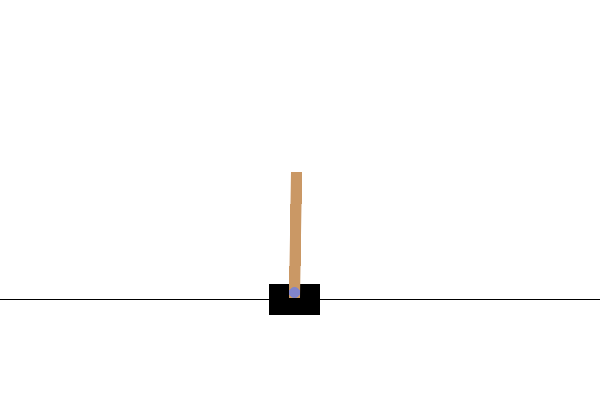

# CartPole Reinforcement Learning Experiments

Small, from-scratch Python experiments in reinforcement learning and control using a custom CartPole simulator.



The animation is from the [Gymnasium CartPole documentation](https://gymnasium.farama.org/environments/classic_control/cart_pole/). Its source and license notice are recorded in [THIRD_PARTY_NOTICES.md](THIRD_PARTY_NOTICES.md).

## What is in this repository?

- `cartpole_actor_critic.py` implements a sigmoid stochastic policy and a linear value function, with actor and critic updates based on a temporal-difference error.
- `CartPole_recursion.py` experiments with a sampled policy and episode returns (a REINFORCE-style update).
- `CartPole_hillclimb.py` tries random changes to a linear controller and keeps changes that improve episode length.
- `actor_critic_working.md` contains notes about the actor-critic update and ideas for further work.

The simulator uses the state `[cart position, cart velocity, pole angle, pole angular velocity]`. An episode ends when the cart moves beyond 2.4 units or the pole angle exceeds 12 degrees.

## Setup

Python 3 and `numpy` and `matplotlib` are required. Install the dependencies with:

```bash
python -m pip install numpy matplotlib
```

## Run an experiment

Run one script at a time from this directory:

```bash
python cartpole_actor_critic.py
```

Or run the other experiments:

```bash
python CartPole_recursion.py
python CartPole_hillclimb.py
```

The scripts print training progress and animate the simulation with Matplotlib. Training duration and results vary because actions and parameter changes involve randomness.

## Project status

These are learning experiments, not a benchmark implementation. Reward design, action-to-force behavior, and training stability are still works in progress; results are not directly comparable to Gymnasium's `CartPole-v1`.